<a target="_blank" href="https://www.microchip.com/" id="top-of-page">
   <picture>
      <source media="(prefers-color-scheme: light)" srcset="images/mchp_logo_light.png" width="350">
      <source media="(prefers-color-scheme: dark)" srcset="images/mchp_logo_dark.png" width="350">
      
   </picture>
</a>

# Intelligent Object Sorting Conveyor System — Client 1 Node

## Introduction
This application demonstrates Client Node 1 as a servo gate controller in an intelligent object sorting conveyor system. Built around the PIC32CM JH01 Curiosity Nano+ Touch Evaluation Kit, the node communicates with the Host node over the 10BASE-T1S single-pair Ethernet network and controls a servomotor to open and close a sorting gate.

  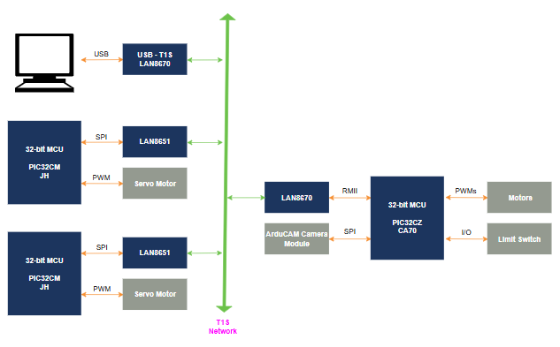
   <b>Figure 1.</b> System Block Diagram

## Modules and Technology Used

- Peripheral modules:
    - PORT
    - SYSTICK
    - SERCOM1–UART
    - SERCOM2–SPI
    - TCC0–PWM
    - EVSYS
    - DMAC
    - NVMCTRL

- Drivers:
    - SPI
    - LAN865x

- System services:
    - Time
    - CONSOLE
    - DEBUG
    - COMMAND
    - wolfCrypt™ library

- Middleware libraries:
    - Harmony Core
    - Cryptographic library

- TCP/IP stack:
     - Application layer
          - DNS client
     - Basic configuration
          - TCPIP CMD
          - TCPIP Core
     - Data link layer
          - NETCONFIG
     - Network layer
          - ARP
          - ICMPV4
          - IPV4
     - Transport layer
          - TCP
          - UDP

  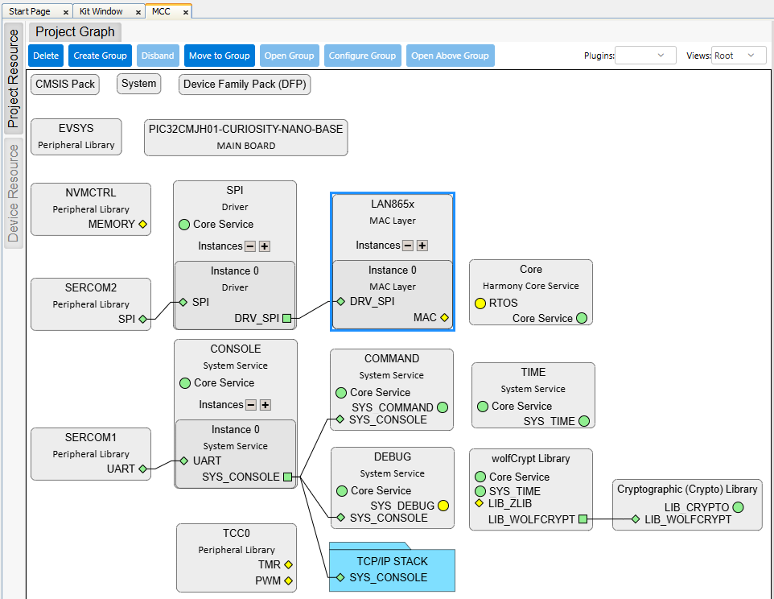
   <b>Figure 2.</b> Project Graph

## Related Documentation

- [PIC32CM5164JH01048 Product Page](https://www.microchip.com/en-us/product/pic32cm5164jh01048)
- [PIC32CM5164JH01048 Code Examples on Discover](https://mplab-discover.microchip.com/v2?dsl=PIC32CM5164JH01048)
- [PIC32CM5164JH01048 Code Examples on Github](https://github.com/Microchip-MPLAB-Harmony/reference_apps_pic32cm)

## Software Used

- [MPLAB® X IDE v6.35](http://www.microchip.com/mplab/mplab-x-ide) or newer
- [MPLAB® XC32 Compiler v6.00](http://www.microchip.com/mplab/compilers) or newer
- [MPLAB® Code Configurator (MCC) v5.7.0](https://www.microchip.com/mplab/mplab-code-configurator) or newer
- [Microchip PIC32CM-JH Series Device Support v1.5.236](https://packs.download.microchip.com/) or newer
- CSP v3.25.1
- CORE v3.16.1
- CMSIS_5 v5.9.1
- Net v3.14.5
- Net_10Base_T1S v1.4.3
- Wolfssl v5.4.0
- Crypto v3.8.2
- MCC Core v5.9.0

## Hardware Used

- [PIC32CM JH01 Curiosity Nano+ Touch Evaluation Kit](https://www.microchip.com/en-us/development-tool/ev29g58a)
- [Curiosity Nano Base For Click Boards™](https://www.microchip.com/en-us/development-tool/AC164162)
- [Two-Wire ETH Click](https://www.mikroe.com/two-wire-eth-click)
- [PROTO Click](https://www.mikroe.com/proto-click)
- [4-Channel Level Converter](https://robu.in/product/smartelex-logic-level-converter-bi-directional/)
- [MG995 Plastic Gear Servo Motor](https://robu.in/product/towerpro-mg995-metal-gear-servo-motor/)
- [Aluminum Servo Horn](https://robu.in/product/aluminum-servo-hornarm-25t-round-type-disc-mg995-mg996/)
- [Servo Motor Mount](design/Servo_Motor_Mount.stl) (3D printable STL file)
- [Servo Slider Arm](design/Servo_Slider_Arm.stl) (3D printable STL file)

## Hardware Modification

- Solder the components on the Proto Click board as shown in the diagram below.
   

     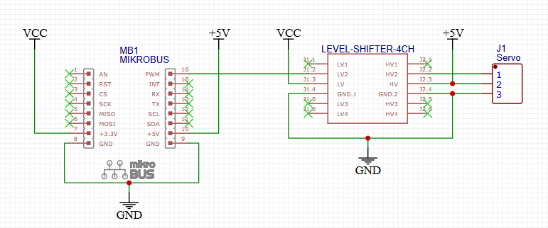
      <b>Figure 3.</b> Hardware Modification Wiring Diagram
   

## Hardware Setup

1. Assemble the sorting gate mechanism using the servomotor, servo slider arm, servo horn, and servomotor mount, as follows:
   

     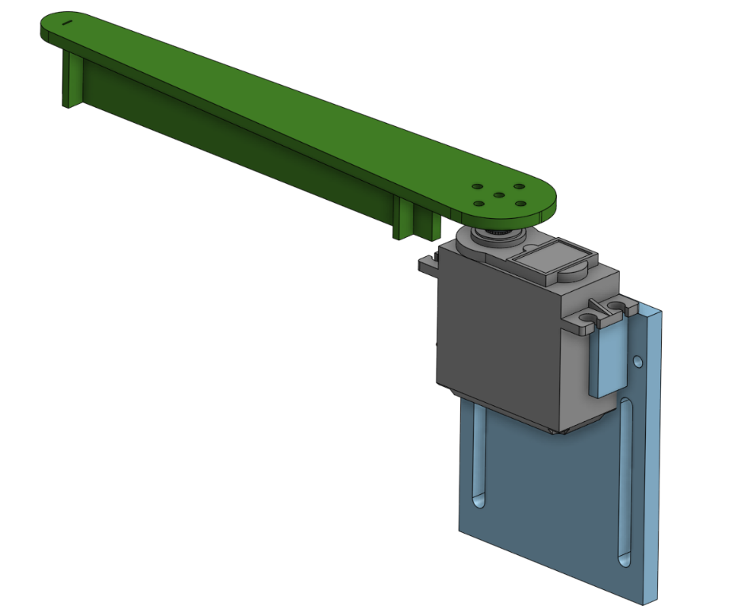
      <b>Figure 4.</b> Servo Motor Assembly
   

  

2. Insert the PIC32CM JH01 Curiosity Nano+ Touch Evaluation Kit onto the Curiosity Nano Base.
   

     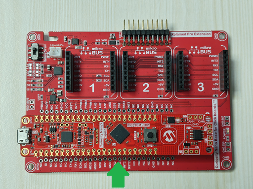
      <b>Figure 5.</b> PIC32CM JH01 Curiosity Nano+ Touch Evaluation Kit Connection
   

  

3. Insert the Two-Wire ETH Click board into the mikroBUS™ Extension 1 on the Curiosity Nano Base.
   

     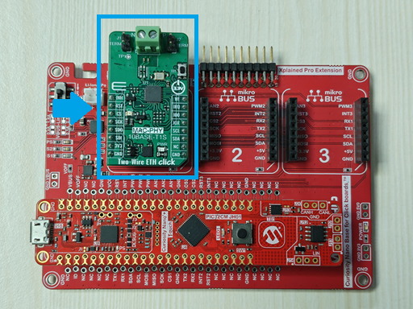
      <b>Figure 6.</b> Two-Wire ETH Click Board™ Connection
   

  

4. Configure the T1S network termination by removing the jumpers on the Two-Wire ETH Click board.
   

     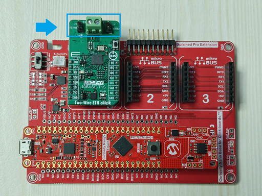
      <b>Figure 7.</b> T1S Network Termination
   

  

5. Connect the Client 1 Node to the T1S network using twisted-pair wiring.
   

     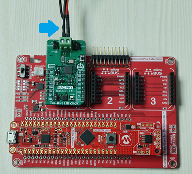
      <b>Figure 8.</b> Client 1 Node T1S Network Connection
   

  

6. Insert the Custom Proto Click board into the mikroBUS Extension 2 on the Curiosity Nano Base.
   

     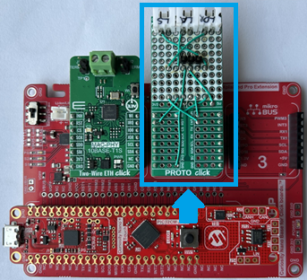
      <b>Figure 9.</b> Custom Proto Click Board Connection
   

  

7. Connect the Servo Motor Connector to the 3-Pin Male on the custom PROTO Click board.
   

     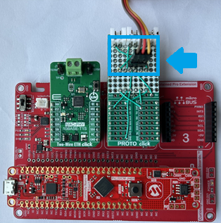
      <b>Figure 10.</b> Servo Motor Connection
   

  

## How to Program the Hex File

The pre-built hex file can be programmed by following the below steps:

1. Open MPLAB X IDE.
2. Close all existing projects in IDE, if any project is opened.
3. Go to _File>Import>Hex/ELF File_.
4. In the Import Image File window, in the Step 1 - Create Prebuilt Project section, click the **Browse** button to select the pre-built hex file.
5. Choose PIC32CM5164JH01048 under Select Device.
6. Ensure the proper tool is selected under Hardware Tool.
7. Click the **Next** button.
8. In the Import Image File window, Step 2 - Select Project Name and Folder, select the appropriate project name and folder.
9. Click the **Finish** button.
10. In MPLAB X IDE, click the **Make and Program Device** button to program the device.
11. Follow the steps in the _Running the Demo_ section below.

## Running the Demo

1. Before starting the Client 1 Node application, ensure that the Host Node is powered on and running.

2. On the host PC, open a serial terminal application, such as Tera Term or PuTTY, and set the baud rate to 115200.

3. To reset the Client 1 Node, press the **Enter** key in the terminal and enter the `reset` command in the serial console.

4. After Reset, the Client 1 Node displays the connection status, including the assigned IP address.
   

     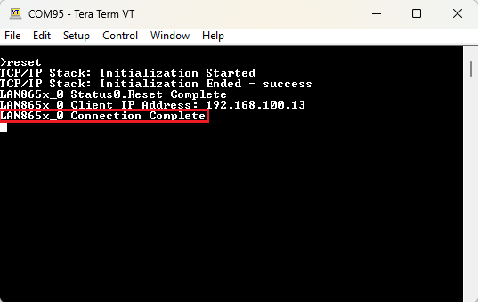
      <b>Figure 11.</b> Client Node Connected
   

5. After successful communication is established with the Host Node, the servo gate responds to commands from the host. When a gate open command is received, the servo gate moves to the open position and the object count is incremented.

6. The gate status (open/closed) and total object count are reported back to the Host Node for monitoring and control.

## Conclusion

This demonstration shows how Client Node 1 operates as a servo gate controller within the 10BASE-T1S multi-node embedded network for an intelligent object sorting conveyor system. Using the PIC32CM JH01 Curiosity Nano+ Touch Evaluation Kit and the Curiosity Nano Base, the node receives gate control commands through the T1S network and actuates the servo motor to open or close the sorting gate.

The demo highlights the coordinated system operation where gate commands are received from the Host Node, and gate status along with object count is reported back for system-wide monitoring.

Overall, this setup illustrates a scalable and connected object sorting solution that combines local edge-node interaction and deterministic T1S communication in a compact embedded system architecture.
